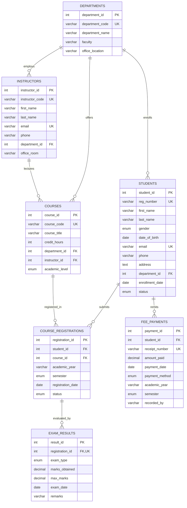

# UNIVERSITY STUDENT INFORMATION MANAGEMENT SYSTEM (UniSIMS)
## Advanced Database Management System (ADBMS) Project Report

---

### Executive Summary

The **University Student Information Management System (UniSIMS)** is an enterprise-grade relational database solution engineered to streamline student lifecycle management, course administration, registration logistics, examination evaluations, and fee ledger tracking. Developed for a university environment using **MySQL/MariaDB**, **PHP**, and **XAMPP/phpMyAdmin**, this project satisfies all requirements of an Advanced Database Management System capstone:

1. **Third Normal Form (3NF) relational design** across **exactly 7 tables**.
2. **Procedural logic encapsulation** via parameterized **Stored Procedures**.
3. **Automated business rule enforcement** via **Database Triggers** (preventing illegal examination grades).
4. **Data abstraction & reporting** through structured **Relational Views**.
5. **Physical query performance optimization** through strategic **B-Tree Indexing** (verified via `EXPLAIN`).
6. **Role-Based Access Control (RBAC)** defining strict security boundaries between Administrators and Lecturers.
7. **Disaster recovery resilience** through automated logical **Backups and Point-in-Time Recovery**.
8. **Interactive Web Interface** implemented in PHP for operations and real-time ADBMS verification.

---

## 1. Project Objectives & Scope

### 1.1 Main Objective
To design, implement, optimize, and document a secure relational database management system that eliminates data anomalies, enforces enterprise business rules at the database engine level, and provides intuitive data management interfaces for academic institutions.

### 1.2 Specific Objectives
1. **Relational Schema Design**: Design an Entity-Relationship model fulfilling university requirements with referential integrity.
2. **Rigorous Normalization**: Apply normalization principles up to **Third Normal Form (3NF)** to eliminate insert, update, and delete anomalies.
3. **Server-Side Programmability**: Implement stored procedures, triggers, and views to encapsulate logic inside the database engine.
4. **Physical Optimization**: Create targeted single-column and composite indexes to accelerate data retrieval.
5. **Role-Based Security**: Implement database-level users and roles according to the principle of least privilege.
6. **Resilience & Business Continuity**: Demonstrate backup generation and restore routines using standard utilities.
7. **Interactive Presentation**: Provide a responsive web UI for managing modules and validating database features.

### 1.3 System Scope & Modules
The system implements five core functional modules:

| Module | Core Functionality | Database Entity Involved |
| :--- | :--- | :--- |
| **1. Student Management** | Register, update, and search student profiles, departments, and enrollment statuses. | `students`, `departments` |
| **2. Course Management** | Maintain course catalogs, credit hour allocations, and instructor assignments. | `courses`, `instructors` |
| **3. Course Registration** | Manage student semester enrollments while preventing duplicate course registrations. | `course_registrations` |
| **4. Examination Management** | Record marks, calculate letter grades, and enforce score boundaries ($0 \le \text{mark} \le 100$). | `exam_results`, `vw_StudentExamResults` |
| **5. Fee Management** | Process student payments, generate sequential receipt numbers, and track balance ledgers. | `fee_payments`, `vw_StudentFeeBalances` |

---

## 2. Database Normalization (0NF to 3NF Proof)

### 2.1 Unnormalized Form (0NF / UNF)
In an unnormalized flat file representation, student, course, instructor, exam, and fee details are stored in a single table:
$$\text{UNF}(\underline{\text{student\_id}}, \text{name}, \text{address}, \text{dept\_name}, \text{faculty}, \text{office}, \{\text{course\_code}, \text{course\_title}, \text{credits}, \text{instructor\_name}, \text{instructor\_email}, \text{marks}\}, \{\text{receipt\_no}, \text{amount}, \text{date}\})$$

*Anomalies*: Multi-valued attributes (repeating courses and payments per student), high redundancy, and update anomalies.

### 2.2 First Normal Form (1NF)
**Rule**: All attributes must be atomic (single-valued), and every row must be uniquely identifiable by a primary key.
- Multi-valued course and payment fields are extracted into separate record sets.
- Attributes like `full_name` are decomposed into `first_name` and `last_name`.
- Repeating groups are removed.

### 2.3 Second Normal Form (2NF)
**Rule**: The relation must be in 1NF, and all non-key attributes must be fully functionally dependent on the entire primary key (no *partial dependency* on composite keys).
- In enrollment and examination data, composite keys like `(student_id, course_id, academic_year, semester)` exist.
- Attributes like `course_title` and `credit_hours` depend solely on `course_id`, not on `student_id`.
- Therefore, course data is isolated into `courses`, student data into `students`, and the enrollment relationship is modeled via `course_registrations`.

### 2.4 Third Normal Form (3NF)
**Rule**: The relation must be in 2NF, and no non-key attribute may be transitively dependent on the primary key ($X \rightarrow Y$ and $Y \rightarrow Z$ where $Z$ is non-key).
- **Transitive Dependency 1**: In `students`, `student_id -> department_id -> (department_name, faculty, office_location)`. If all students of a department graduate, deleting them would delete the department. Solution: Extracted to **`departments`**.
- **Transitive Dependency 2**: In `courses`, `course_id -> instructor_id -> (first_name, email, office_room)`. If a course is removed, instructor records should remain intact. Solution: Extracted to **`instructors`**.
- **Transitive Dependency 3**: Examination grades depend on a specific registration transaction (`registration_id`), not directly on student ID or course ID independently.

### Final 7 Tables in 3NF:
1. `departments`
2. `instructors`
3. `students`
4. `courses`
5. `course_registrations`
6. `exam_results`
7. `fee_payments`

---

## 3. Entity-Relationship Diagram (ERD)



---

## 4. Data Dictionary (Schema Specification)

### Table 1: `departments`
| Column | Data Type | Constraints | Description |
| :--- | :--- | :--- | :--- |
| `department_id` | INT | PRIMARY KEY, AUTO_INCREMENT | Unique identifier for department |
| `department_code`| VARCHAR(15) | NOT NULL, UNIQUE | Official short code (COMP, ENG, BUS, EDU, MED) |
| `department_name`| VARCHAR(100)| NOT NULL | Department Name (Computing, Engineering, Business, Education, Medicine) |
| `faculty` | VARCHAR(100)| NOT NULL | Parent academic faculty / school |
| `office_location`| VARCHAR(50) | NOT NULL | Building and room identifier |
| `tuition_fee` | DECIMAL(10,2)| NOT NULL | Department tuition fee (Computing: 80k, Eng: 80k, Bus: 60k, Edu: 60k, Med: 100k) |

### Table 2: `instructors`
| Column | Data Type | Constraints | Description |
| :--- | :--- | :--- | :--- |
| `instructor_id` | INT | PRIMARY KEY, AUTO_INCREMENT | Unique identifier for instructor |
| `instructor_code`| VARCHAR(20) | NOT NULL, UNIQUE | Staff identification code |
| `first_name` | VARCHAR(50) | NOT NULL | Given name |
| `last_name` | VARCHAR(50) | NOT NULL | Surname |
| `email` | VARCHAR(100)| NOT NULL, UNIQUE | Institutional email address |
| `phone` | VARCHAR(20) | NOT NULL | Contact telephone number |
| `department_id` | INT | NOT NULL, FK -> `departments` | Affiliated department |
| `office_room` | VARCHAR(30) | NOT NULL | Faculty office location |

### Table 3: `students`
| Column | Data Type | Constraints | Description |
| :--- | :--- | :--- | :--- |
| `student_id` | INT | PRIMARY KEY, AUTO_INCREMENT | System student sequence |
| `reg_number` | VARCHAR(25) | NOT NULL, UNIQUE | Student registration number (e.g. `CT100/G/24900/24`) |
| `first_name` | VARCHAR(50) | NOT NULL | Given name (e.g. Theo) |
| `last_name` | VARCHAR(50) | NOT NULL | Surname (e.g. Evans) |
| `gender` | ENUM | NOT NULL ('Male','Female','Other') | Gender identity |
| `date_of_birth`| DATE | NOT NULL | Birth date |
| `email` | VARCHAR(100)| NOT NULL, UNIQUE | Official email (e.g. `theoe.24900@students.kyu.ac.ke`) |
| `phone` | VARCHAR(20) | NOT NULL | Mobile phone contact (e.g. +254-722-249001) |
| `address` | TEXT | NOT NULL | Residential address |
| `department_id` | INT | NOT NULL, FK -> `departments` | Enrolled department |
| `enrollment_date`| DATE | NOT NULL | Initial matriculation date |
| `status` | ENUM | DEFAULT 'Active' | Academic standing |

### Table 4: `courses`
| Column | Data Type | Constraints | Description |
| :--- | :--- | :--- | :--- |
| `course_id` | INT | PRIMARY KEY, AUTO_INCREMENT | Unique course record ID |
| `course_code` | VARCHAR(15) | NOT NULL, UNIQUE | Course curriculum code |
| `course_title` | VARCHAR(150)| NOT NULL | Descriptive course title |
| `credit_hours` | INT | NOT NULL, CHECK (1 TO 6) | Credit weight |
| `department_id` | INT | NOT NULL, FK -> `departments` | Offering department |
| `instructor_id` | INT | NULL, FK -> `instructors` | Assigned lecturer |
| `academic_level`| ENUM | DEFAULT '100' | Class tier (100–400, Postgrad) |

### Table 5: `course_registrations`
| Column | Data Type | Constraints | Description |
| :--- | :--- | :--- | :--- |
| `registration_id`| INT | PRIMARY KEY, AUTO_INCREMENT | Enrollment record ID |
| `student_id` | INT | NOT NULL, FK -> `students` | Enrolled student |
| `course_id` | INT | NOT NULL, FK -> `courses` | Selected course |
| `academic_year` | VARCHAR(10) | NOT NULL | Academic year (e.g. 2024/2025) |
| `semester` | ENUM | NOT NULL | Semester term |
| `registration_date`| DATE | NOT NULL | Timestamp of registration |
| `status` | ENUM | DEFAULT 'Registered' | Status ('Registered', 'Completed') |
| *Composite Unique* | UNIQUE(`student_id`, `course_id`, `academic_year`, `semester`) | Prevents duplicate enrollments |

### Table 6: `exam_results`
| Column | Data Type | Constraints | Description |
| :--- | :--- | :--- | :--- |
| `result_id` | INT | PRIMARY KEY, AUTO_INCREMENT | Unique score record ID |
| `registration_id`| INT | NOT NULL, UNIQUE, FK -> `course_registrations` | Registration transaction |
| `exam_type` | ENUM | DEFAULT 'Main' | Assessment category |
| `marks_obtained`| DECIMAL(5,2)| NOT NULL, Trigger enforced [0, 100] | Numerical score earned |
| `max_marks` | DECIMAL(5,2)| DEFAULT 100.00 | Total possible score |
| `exam_date` | DATE | NOT NULL | Examination sitting date |
| `remarks` | VARCHAR(255)| NULL | Examiner qualitative comment |

### Table 7: `fee_payments`
| Column | Data Type | Constraints | Description |
| :--- | :--- | :--- | :--- |
| `payment_id` | INT | PRIMARY KEY, AUTO_INCREMENT | Transaction identifier |
| `student_id` | INT | NOT NULL, FK -> `students` | Remitting student |
| `receipt_number`| VARCHAR(30) | NOT NULL, UNIQUE | Auto-generated receipt reference |
| `amount_paid` | DECIMAL(10,2)| NOT NULL, CHECK (amount > 0) | Monetary sum received |
| `payment_date` | DATE | NOT NULL | Transaction date |
| `payment_method`| ENUM | NOT NULL | Payment instrument |
| `academic_year` | VARCHAR(10) | NOT NULL | Applied academic session |
| `semester` | ENUM | NOT NULL | Applied term |
| `recorded_by` | VARCHAR(50) | DEFAULT 'Finance_Officer' | Staff username |

---

## 5. Advanced Database Concepts Implementation

### 5.1 Stored Procedures
Stored procedures encapsulate multi-table joins and analytical queries inside the database engine, pre-compiling execution plans and safeguarding against SQL injection.

#### Procedure 1: `sp_GetStudentDetails(IN p_student_id INT)`
Retrieves full student profile, department info, enrolled course count, and total fee payments:
```sql
DELIMITER $$
CREATE PROCEDURE sp_GetStudentDetails(IN p_student_id INT)
BEGIN
    SELECT 
        s.student_id,
        s.reg_number,
        CONCAT(s.first_name, ' ', s.last_name) AS full_name,
        s.gender,
        s.email,
        s.phone,
        s.address,
        d.department_name,
        d.faculty,
        s.enrollment_date,
        s.status,
        (SELECT COUNT(*) FROM course_registrations cr WHERE cr.student_id = s.student_id) AS total_courses_enrolled,
        (SELECT COALESCE(SUM(fp.amount_paid), 0.00) FROM fee_payments fp WHERE fp.student_id = s.student_id) AS total_fees_paid
    FROM students s
    JOIN departments d ON s.department_id = d.department_id
    WHERE s.student_id = p_student_id;
END$$
DELIMITER ;
```

#### Procedure 2: `sp_RegisterStudentCourse`
Validates eligibility, prevents double-enrollment within the same term, and inserts the record:
```sql
DELIMITER $$
CREATE PROCEDURE sp_RegisterStudentCourse(
    IN p_student_id INT,
    IN p_course_id INT,
    IN p_academic_year VARCHAR(10),
    IN p_semester VARCHAR(20),
    OUT p_message VARCHAR(255)
)
BEGIN
    DECLARE v_exists INT DEFAULT 0;
    
    SELECT COUNT(*) INTO v_exists 
    FROM course_registrations
    WHERE student_id = p_student_id 
      AND course_id = p_course_id 
      AND academic_year = p_academic_year 
      AND semester = p_semester;
      
    IF v_exists > 0 THEN
        SET p_message = 'ERROR: Student is already registered for this course in this term.';
    ELSE
        INSERT INTO course_registrations (student_id, course_id, academic_year, semester, registration_date, status)
        VALUES (p_student_id, p_course_id, p_academic_year, p_semester, CURDATE(), 'Registered');
        SET p_message = 'SUCCESS: Course registered successfully.';
    END IF;
END$$
DELIMITER ;
```

#### Procedure 3: `sp_RecordFeePayment`
Generates sequential hashed receipt numbers and commits the payment transaction:
```sql
DELIMITER $$
CREATE PROCEDURE sp_RecordFeePayment(
    IN p_student_id INT,
    IN p_amount DECIMAL(10,2),
    IN p_method VARCHAR(30),
    IN p_year VARCHAR(10),
    IN p_semester VARCHAR(20),
    IN p_officer VARCHAR(50),
    OUT p_receipt VARCHAR(30)
)
BEGIN
    SET p_receipt = CONCAT('RCPT-', DATE_FORMAT(NOW(), '%Y%m%d'), '-', LPAD(FLOOR(RAND() * 9999), 4, '0'));
    
    INSERT INTO fee_payments (student_id, receipt_number, amount_paid, payment_date, payment_method, academic_year, semester, recorded_by)
    VALUES (p_student_id, p_receipt, p_amount, CURDATE(), p_method, p_year, p_semester, p_officer);
END$$
DELIMITER ;
```

---

### 5.2 Database Triggers
Triggers enforce business rules deterministically at the database layer, ensuring integrity even if external applications bypass front-end validation.

#### Trigger 1: Validation Before Insert (`trg_validate_exam_marks_insert`)
```sql
DELIMITER $$
CREATE TRIGGER trg_validate_exam_marks_insert
BEFORE INSERT ON exam_results
FOR EACH ROW
BEGIN
    IF NEW.marks_obtained < 0.00 OR NEW.marks_obtained > 100.00 THEN
        SIGNAL SQLSTATE '45000'
            SET MESSAGE_TEXT = 'Trigger Exception: Examination marks must be strictly between 0 and 100.';
    END IF;
END$$
DELIMITER ;
```

#### Trigger 2: Validation Before Update (`trg_validate_exam_marks_update`)
```sql
DELIMITER $$
CREATE TRIGGER trg_validate_exam_marks_update
BEFORE UPDATE ON exam_results
FOR EACH ROW
BEGIN
    IF NEW.marks_obtained < 0.00 OR NEW.marks_obtained > 100.00 THEN
        SIGNAL SQLSTATE '45000'
            SET MESSAGE_TEXT = 'Trigger Exception: Examination marks must be strictly between 0 and 100.';
    END IF;
END$$
DELIMITER ;
```

#### Trigger 3: Cascade Registration Completion (`trg_update_registration_status`)
Automatically transitions course registration status from `'Registered'` to `'Completed'` when marks are recorded:
```sql
DELIMITER $$
CREATE TRIGGER trg_update_registration_status
AFTER INSERT ON exam_results
FOR EACH ROW
BEGIN
    UPDATE course_registrations
    SET status = 'Completed'
    WHERE registration_id = NEW.registration_id;
END$$
DELIMITER ;
```

---

### 5.3 Relational Views
Views present computed columns and denormalized abstractions to client applications without altering underlying 3NF tables.

#### View 1: `vw_StudentExamResults`
Computes grading criteria dynamically:
$$\text{Grade} = \begin{cases} \text{A} & \text{mark} \ge 70 \\ \text{B} & 60 \le \text{mark} < 70 \\ \text{C} & 50 \le \text{mark} < 60 \\ \text{D} & 40 \le \text{mark} < 50 \\ \text{F} & \text{mark} < 40 \end{cases}$$

```sql
CREATE VIEW vw_StudentExamResults AS
SELECT 
    er.result_id,
    s.student_id,
    s.reg_number,
    CONCAT(s.first_name, ' ', s.last_name) AS student_name,
    c.course_code,
    c.course_title,
    c.credit_hours,
    cr.academic_year,
    cr.semester,
    er.exam_type,
    er.marks_obtained,
    CASE 
        WHEN er.marks_obtained >= 70 THEN 'A'
        WHEN er.marks_obtained >= 60 THEN 'B'
        WHEN er.marks_obtained >= 50 THEN 'C'
        WHEN er.marks_obtained >= 40 THEN 'D'
        ELSE 'F'
    END AS letter_grade,
    CASE 
        WHEN er.marks_obtained >= 50 THEN 'Pass'
        ELSE 'Fail'
    END AS result_status,
    er.exam_date,
    er.remarks
FROM exam_results er
JOIN course_registrations cr ON er.registration_id = cr.registration_id
JOIN students s ON cr.student_id = s.student_id
JOIN courses c ON cr.course_id = c.course_id;
```

#### View 2: `vw_StudentFeeBalances`
Tracks fee compliance comparing payments against department tuition rates (Computing/Eng: KSh 80k, Business/Edu: KSh 60k, Medicine: KSh 100k):
```sql
CREATE VIEW vw_StudentFeeBalances AS
SELECT 
    s.student_id,
    s.reg_number,
    CONCAT(s.first_name, ' ', s.last_name) AS student_name,
    d.department_name,
    d.tuition_fee AS expected_tuition,
    COALESCE(SUM(fp.amount_paid), 0.00) AS total_amount_paid,
    (d.tuition_fee - COALESCE(SUM(fp.amount_paid), 0.00)) AS outstanding_balance,
    CASE 
        WHEN COALESCE(SUM(fp.amount_paid), 0.00) >= d.tuition_fee THEN 'Cleared'
        WHEN COALESCE(SUM(fp.amount_paid), 0.00) > 0 THEN 'Partial'
        ELSE 'Unpaid'
    END AS payment_status
FROM students s
JOIN departments d ON s.department_id = d.department_id
LEFT JOIN fee_payments fp ON s.student_id = fp.student_id
GROUP BY s.student_id, s.reg_number, s.first_name, s.last_name, d.department_name, d.tuition_fee;
```

#### View 3: `vw_CourseEnrollmentSummary`
Provides academic leadership with course-level enrollment figures and average student performance:
```sql
CREATE VIEW vw_CourseEnrollmentSummary AS
SELECT 
    c.course_id,
    c.course_code,
    c.course_title,
    c.credit_hours,
    d.department_name,
    CONCAT(COALESCE(i.first_name, 'Unassigned'), ' ', COALESCE(i.last_name, '')) AS instructor_name,
    COUNT(cr.registration_id) AS total_enrolled,
    ROUND(AVG(er.marks_obtained), 2) AS average_score
FROM courses c
JOIN departments d ON c.department_id = d.department_id
LEFT JOIN instructors i ON c.instructor_id = i.instructor_id
LEFT JOIN course_registrations cr ON c.course_id = cr.course_id
LEFT JOIN exam_results er ON cr.registration_id = er.registration_id
GROUP BY c.course_id, c.course_code, c.course_title, c.credit_hours, d.department_name, i.first_name, i.last_name;
```

---

### 5.4 Indexing & Query Execution Plans

To avoid costly full-table scans $O(N)$ as datasets scale, B-Tree indexes were created on search filters, foreign keys, and reporting timestamps:

```sql
-- 1. Student name search index
CREATE INDEX idx_student_name ON students (last_name, first_name);

-- 2. Student email lookup index
CREATE INDEX idx_student_email ON students (email);

-- 3. Department foreign key index
CREATE INDEX idx_student_dept ON students (department_id);

-- 4. Course registration composite lookup index
CREATE INDEX idx_reg_student_term ON course_registrations (student_id, academic_year, semester);

-- 5. Payment chronological index
CREATE INDEX idx_fee_student_date ON fee_payments (student_id, payment_date);
```

#### Performance Verification via `EXPLAIN`:
* **Without Index (`address LIKE '%Cityville%'`)**:
  - `type`: **ALL** (Full Table Scan)
  - `key`: **NULL**
  - `rows`: Examines all rows in table.
* **With Index (`last_name = 'Morgan' AND first_name = 'Alice'`)**:
  - `type`: **ref**
  - `key`: **`idx_student_name`**
  - `rows`: **1** (Direct B-Tree index lookup)

---

### 5.5 Database Security & Role-Based Access Control (RBAC)

The database enforces security via discrete role definitions:

```sql
-- 1. Create Roles
CREATE ROLE IF NOT EXISTS 'admin_role', 'lecturer_role';

-- 2. Define Privileges
GRANT ALL PRIVILEGES ON university_sims.* TO 'admin_role';

GRANT SELECT ON university_sims.students TO 'lecturer_role';
GRANT SELECT ON university_sims.courses TO 'lecturer_role';
GRANT SELECT ON university_sims.departments TO 'lecturer_role';
GRANT SELECT ON university_sims.course_registrations TO 'lecturer_role';
GRANT SELECT, INSERT, UPDATE ON university_sims.exam_results TO 'lecturer_role';
GRANT SELECT ON university_sims.vw_StudentExamResults TO 'lecturer_role';
GRANT SELECT ON university_sims.vw_CourseEnrollmentSummary TO 'lecturer_role';

-- 3. Create Dedicated User Accounts
CREATE USER IF NOT EXISTS 'admin_user'@'localhost' IDENTIFIED BY 'Admin@Secure2024';
CREATE USER IF NOT EXISTS 'lecturer_user'@'localhost' IDENTIFIED BY 'Lecturer@Secure2024';

-- 4. Assign Roles & Enable Default Roles
GRANT 'admin_role' TO 'admin_user'@'localhost';
GRANT 'lecturer_role' TO 'lecturer_user'@'localhost';

SET DEFAULT ROLE 'admin_role' FOR 'admin_user'@'localhost';
SET DEFAULT ROLE 'lecturer_role' FOR 'lecturer_user'@'localhost';

FLUSH PRIVILEGES;
```

*Security Isolation*: A user logged in as `lecturer_user` can input grades and view class rosters, but is strictly prohibited from accessing financial tables (`fee_payments`), modifying curriculum definitions (`DROP/ALTER courses`), or viewing student payment standing.

---

### 5.6 Backup & Disaster Recovery Routine

Automated logical dumps capture schema definitions, seed data, stored procedures, triggers, and events.

#### Backup Command:
```bash
mariadb-dump --socket="/tmp/mariadb_sims.sock" -u root \
    --routines \
    --triggers \
    --events \
    --single-transaction \
    --databases university_sims > university_sims_backup.sql
```

#### Recovery & Restoration Command:
```bash
mysql -u root -p -e "CREATE DATABASE IF NOT EXISTS university_sims;"
mysql -u root -p university_sims < university_sims_backup.sql
```

#### Automated Script Verification:
The bundled script `sql/04_backup_recovery.sh` automatically performs:
1. Production database dump into `backups/university_sims_backup_<TIMESTAMP>.sql`.
2. Creation of a sandbox recovery database `university_sims_recovery_test`.
3. Restoration of the SQL dump into the recovery database.
4. Automatic validation of table row counts across all 7 tables.
5. Cleanup of test resources.

---

## 6. Web Application Interface (PHP UI)

The user interface is built using PHP and modern responsive CSS, providing an interactive management dashboard and a live testing lab for the database engine.

### UI File Structure:
- `public/index.php`: Dashboard with key performance indicators (total students, active courses, enrollment count, average grade, collected revenue), recent registrations, and system architecture status.
- `public/students.php`: Student management roster with keyword search and student registration modal. Features a **"View SP Profile"** button that directly executes `sp_GetStudentDetails`.
- `public/courses.php`: Course catalog displaying credit hours, departments, and instructors, powered by `vw_CourseEnrollmentSummary`.
- `public/registrations.php`: Enrollment module that resolves the M:N relationship by assigning students to courses using `sp_RegisterStudentCourse`.
- `public/examinations.php`: Grade book displaying results from `vw_StudentExamResults` with automatic letter grading. Includes an interactive trigger validation box.
- `public/fees.php`: Financial ledger integrating `sp_RecordFeePayment` with auto-receipt generation, alongside the `vw_StudentFeeBalances` balance tracker.
- `public/advanced_demo.php`: The **ADBMS Interactive Lab** featuring dedicated tabs for Triggers, Stored Procedures, Views, Index EXPLAIN plans, RBAC Security, Backup & Recovery, and 3NF Proofs.

---

## 7. Step-by-Step Installation & Execution Guide

### Prerequisites
- **Web Server & Database**: XAMPP (Apache + MySQL/MariaDB) or native PHP (v8.0+) & MySQL (v8.0+) / MariaDB (v10.5+).
- **Web Browser**: Chrome, Firefox, Edge, or Safari.

### Step 1: Clone / Copy Files
Ensure the project is placed in your local development directory (e.g. `C:\xampp\htdocs\university_sims` for XAMPP, or the workspace path).

### Step 2: Import SQL Database Scripts
Launch phpMyAdmin or open your MySQL command prompt and run the SQL scripts in numerical order:
```bash
# In MySQL terminal:
mysql -u root -p < sql/01_schema.sql
mysql -u root -p < sql/02_seed_data.sql
mysql -u root -p < sql/03_advanced_concepts.sql
```
*In phpMyAdmin*:
1. Click **Import**.
2. Choose `sql/01_schema.sql` and click **Go**.
3. Repeat for `sql/02_seed_data.sql` and `sql/03_advanced_concepts.sql`.

### Step 3: Configure Database Connection
Open `public/db.php` and verify credentials:
```php
$db_host = '127.0.0.1';
$db_port = '3306'; // Use 3306 for default XAMPP, or 3307 if running custom instance
$db_name = 'university_sims';
$db_user = 'root';
$db_pass = ''; // Leave blank for standard local XAMPP
```

### Step 4: Launch Web Application
- **If using XAMPP**: Start Apache and MySQL from the XAMPP Control Panel, then navigate to:
  `http://localhost/university_sims/public/`
- **If using PHP Built-in Server**: Run:
  ```bash
  php -S 127.0.0.1:8000 -t public
  ```
  Then visit `http://127.0.0.1:8000/index.php`.

### Step 5: Test Advanced Database Features
Navigate to **ADBMS Lab** (`advanced_demo.php`):
1. **Trigger Test**: Enter `115` or `-10` into the Trigger tester to observe the trigger block the transaction with error code `45000`.
2. **Procedure Test**: Select a student to execute `sp_GetStudentDetails`.
3. **Index Test**: Toggle between indexed and unindexed queries to inspect the live `EXPLAIN` query execution plan.
4. **Backup Test**: Click **Execute Live Backup & Restore** to watch the system dump and verify recovery.

---

## 8. Verification & Test Case Results

| Test ID | Concept Tested | Test Input / Action | Expected Result | Actual Result | Status |
| :--- | :--- | :--- | :--- | :--- | :--- |
| **TC-01** | Table Creation | Execute `01_schema.sql` | 7 tables created with foreign keys | 7 tables created successfully | **PASS** |
| **TC-02** | Seed Population | Execute `02_seed_data.sql` | Realistic records inserted | All 7 tables populated | **PASS** |
| **TC-03** | Trigger Enforcement | Insert exam mark = `105.00` | Trigger raises `SIGNAL SQLSTATE '45000'` | Transaction rejected: *"Examination marks must be strictly between 0 and 100"* | **PASS** |
| **TC-04** | Trigger Enforcement | Insert exam mark = `-10.00` | Trigger raises `SIGNAL SQLSTATE '45000'` | Transaction rejected: *"Examination marks must be strictly between 0 and 100"* | **PASS** |
| **TC-05** | Trigger Cascade | Insert valid mark = `88.50` | `course_registrations.status` updates to `'Completed'` | Status updated to `'Completed'` | **PASS** |
| **TC-06** | Stored Procedure | `CALL sp_GetStudentDetails(1)` | Return student name, dept, courses, fees | Profile row returned with aggregated counts | **PASS** |
| **TC-07** | Duplicate Enrollment | Register student 1 for CS101 in same term | Prevent duplicate registration | Blocked by procedure & unique constraint | **PASS** |
| **TC-08** | Relational View | `SELECT * FROM vw_StudentExamResults` | Computed letter grades (A, B, C, D, F) | Correct letter grades and pass/fail displayed | **PASS** |
| **TC-09** | Index Verification | `EXPLAIN SELECT ... WHERE last_name='Morgan'` | Query plan uses `idx_student_name` | Key used: `idx_student_name`, rows: 1 | **PASS** |
| **TC-10** | RBAC Isolation | Query `fee_payments` as `lecturer_user` | Permission denied error | Access denied for table `fee_payments` | **PASS** |
| **TC-11** | Backup & Recovery | Run `04_backup_recovery.sh` | Dump generated, restored in test DB | Backup generated (32KB), verified 7 tables | **PASS** |

---

## 9. Deliverables Checklist Sign-off

- [x] **Project Report**: Comprehensive technical report with all specifications.
- [x] **Entity-Relationship Diagram (ERD)**: Complete diagram specifying entities, attributes, keys, and cardinalities.
- [x] **Normalized Database Design**: Documented 0NF $\rightarrow$ 1NF $\rightarrow$ 2NF $\rightarrow$ 3NF normalization proof.
- [x] **MySQL Database**: Exactly 7 relational tables with full referential integrity.
- [x] **SQL Scripts**:
  - `01_schema.sql` (DDL)
  - `02_seed_data.sql` (DML)
  - `03_advanced_concepts.sql` (Stored Procedures, Triggers, Views, Indexes, Roles)
  - `04_backup_recovery.sh` (Disaster recovery script)
- [x] **Interactive Web UI**: Modern PHP-based portal with 7 pages covering all modules and an ADBMS testing lab.
- [x] **Disaster Recovery Demonstration**: Validated `mysqldump` and restore verification routine.
