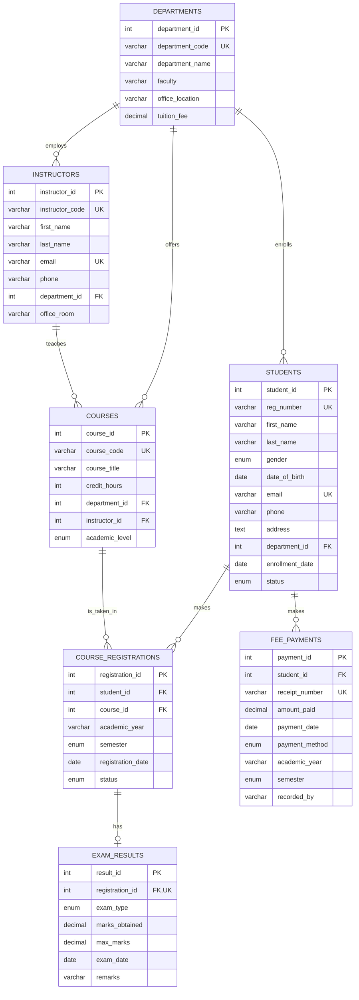

# University Student Information Management System (UniSIMS)

Advanced Database Management Systems (ADBMS) Project Report

## Group Members

| No. | Registration Number | Full Name |
| :--- | :--- | :--- |
| 1 | CT100/G/24900/24 | Kennedy Mwiti Kalawa |
| 2 | CT100/G/24222/24 | Nteere Chris Koome |
| 3 | CT100/G/24903/24 | Octavious Antony |
| 4 | CT100/G/22911/24 | Abel Kihara |
| 5 | CT100/G/23005/24 | Ian Kimemia |

---

## Summary

UniSIMS is a relational database for keeping a university's student records. It handles student profiles, the course catalogue, course registration, exam marks and fee payments. The database runs on MySQL or MariaDB, with a PHP web interface on top. Setup uses XAMPP and phpMyAdmin.

The schema has seven tables in Third Normal Form (3NF). Most of the business rules sit in the database rather than in the web pages, so they still apply if another program writes to the tables. The project includes:

- Stored procedures for student lookups, course registration and fee recording
- Triggers that reject marks outside the 0 to 100 range and update registration status when a result is saved
- Views for exam grades and fee balances
- B-Tree indexes, checked with `EXPLAIN`
- Two database roles, one for administrators and one for lecturers
- A backup script that dumps the database and restores it into a separate test database to confirm the dump works

---

## 1. Objectives and Scope

### 1.1 Aim

The aim was to build a database that avoids duplicated and inconsistent data, enforces the main rules inside the database engine, and gives staff a web interface for daily work.

### 1.2 Objectives

1. Design an entity-relationship model with referential integrity.
2. Normalize the design to Third Normal Form.
3. Put procedural logic in stored procedures, triggers and views.
4. Add indexes for the searches the system runs most often.
5. Create database roles that follow the principle of least privilege.
6. Show that a backup can be restored.
7. Provide a web interface for each module and for testing the database features.

### 1.3 Modules

The system has five modules.

| Module | What it does | Tables and views used |
| :--- | :--- | :--- |
| Student management | Adds and updates student profiles, departments and enrollment status, and supports search. | `students`, `departments` |
| Course management | Keeps the course catalogue, credit hours and instructor assignments. | `courses`, `instructors` |
| Course registration | Records a student's enrollment in a course for a term and blocks duplicate registrations. | `course_registrations` |
| Examinations | Records marks, assigns letter grades and rejects marks outside 0 to 100. | `exam_results`, `vw_StudentExamResults` |
| Fee management | Records payments with a receipt number and tracks each student's balance against tuition. | `fee_payments`, `vw_StudentFeeBalances` |

---

## 2. Normalization

### 2.1 Unnormalized Form (UNF)

If all the data sat in one flat table, each row would hold a student, their department, every course they take with the instructor and marks for each, and every payment they have made:

$$\text{UNF}(\underline{\text{student\_id}}, \text{name}, \text{address}, \text{dept\_name}, \text{faculty}, \text{office}, \{\text{course\_code}, \text{course\_title}, \text{credits}, \text{instructor\_name}, \text{instructor\_email}, \text{marks}\}, \{\text{receipt\_no}, \text{amount}, \text{date}\})$$

This design has three problems. It has repeating groups of courses and payments. It stores the same department and course details many times. And a change to one fact, such as an instructor's email, would have to be made in every row that mentions it.

### 2.2 First Normal Form (1NF)

A table is in 1NF when every column holds a single value and every row can be identified by a key.

- Course and payment groups move into their own rows, so each course registration and each payment is a separate record.
- `full_name` is split into `first_name` and `last_name`, so either part can be searched on its own.

### 2.3 Second Normal Form (2NF)

A table is in 2NF when it is in 1NF and every non-key column depends on the whole key. This matters for tables with composite keys, such as a registration identified by `(student_id, course_id, academic_year, semester)`.

`course_title` and `credit_hours` depend only on `course_id`, not on the student. Keeping them in the registration table would repeat them for every student taking the course. They therefore move to `courses`, personal details stay in `students`, and the link between the two is held in `course_registrations`.

### 2.4 Third Normal Form (3NF)

A table is in 3NF when it is in 2NF and no non-key column depends on another non-key column.

- **Transitive dependency 1.** In `students`, `student_id` determines `department_id`, which determines `department_name`, `faculty` and `office_location`. If the department details lived in `students`, deleting the last student of a department would also delete the department's details. The department attributes move to `departments`.
- **Transitive dependency 2.** In `courses`, `course_id` determines `instructor_id`, which determines the instructor's name, email and office. Removing a course should not remove the instructor, so those attributes move to `instructors`.
- **No dependency through students or courses in `exam_results`.** An exam result depends on a single course registration, identified by `registration_id`. The registration already links the student and the course, so `exam_results` stores only the registration reference and facts about the exam itself. The student and course are not repeated there.

The result is seven tables:

1. `departments`
2. `instructors`
3. `students`
4. `courses`
5. `course_registrations`
6. `exam_results`
7. `fee_payments`

---

## 3. Entity-Relationship Diagram



Each line reads from parent to child. For example, one department can have many students, and each registration has at most one exam result.

---

## 4. Data Dictionary

### Table 1: `departments`

| Column | Type | Constraints | Description |
| :--- | :--- | :--- | :--- |
| `department_id` | INT | Primary key, auto-increment | Department identifier |
| `department_code` | VARCHAR(15) | Not null, unique | Short code: COMP, ENG, BUS, EDU or MED |
| `department_name` | VARCHAR(100) | Not null | Full name of the department |
| `faculty` | VARCHAR(100) | Not null | Faculty or school the department belongs to |
| `office_location` | VARCHAR(50) | Not null | Building and room |
| `tuition_fee` | DECIMAL(10,2) | Not null | Tuition for the department, in KSh |

### Table 2: `instructors`

| Column | Type | Constraints | Description |
| :--- | :--- | :--- | :--- |
| `instructor_id` | INT | Primary key, auto-increment | Instructor identifier |
| `instructor_code` | VARCHAR(20) | Not null, unique | Staff identification code |
| `first_name` | VARCHAR(50) | Not null | Given name |
| `last_name` | VARCHAR(50) | Not null | Surname |
| `email` | VARCHAR(100) | Not null, unique | Institutional email |
| `phone` | VARCHAR(20) | Not null | Contact number |
| `department_id` | INT | Not null, foreign key to `departments` | Department the instructor belongs to |
| `office_room` | VARCHAR(30) | Not null | Office location |

### Table 3: `students`

| Column | Type | Constraints | Description |
| :--- | :--- | :--- | :--- |
| `student_id` | INT | Primary key, auto-increment | Internal student number |
| `reg_number` | VARCHAR(25) | Not null, unique | Registration number, in the form `CT100/G/24900/24` |
| `first_name` | VARCHAR(50) | Not null | Given name |
| `last_name` | VARCHAR(50) | Not null | Surname |
| `gender` | ENUM | Not null: Male, Female or Other | Recorded gender |
| `date_of_birth` | DATE | Not null | Date of birth |
| `email` | VARCHAR(100) | Not null, unique | Institutional email |
| `phone` | VARCHAR(20) | Not null | Mobile number |
| `address` | TEXT | Not null | Residential address |
| `department_id` | INT | Not null, foreign key to `departments` | Department the student is enrolled in |
| `enrollment_date` | DATE | Not null | Date of first enrollment |
| `status` | ENUM | Default `Active` | Academic standing |

### Table 4: `courses`

| Column | Type | Constraints | Description |
| :--- | :--- | :--- | :--- |
| `course_id` | INT | Primary key, auto-increment | Internal course number |
| `course_code` | VARCHAR(15) | Not null, unique | Code from the curriculum |
| `course_title` | VARCHAR(150) | Not null | Course title |
| `credit_hours` | INT | Not null, check between 1 and 6 | Credit weight |
| `department_id` | INT | Not null, foreign key to `departments` | Department that offers the course |
| `instructor_id` | INT | Nullable, foreign key to `instructors` | Assigned lecturer |
| `academic_level` | ENUM | Default `100` | Level: 100, 200, 300, 400 or Postgraduate |

### Table 5: `course_registrations`

| Column | Type | Constraints | Description |
| :--- | :--- | :--- | :--- |
| `registration_id` | INT | Primary key, auto-increment | Registration identifier |
| `student_id` | INT | Not null, foreign key to `students` | Student |
| `course_id` | INT | Not null, foreign key to `courses` | Course |
| `academic_year` | VARCHAR(10) | Not null | Academic year, for example 2024/2025 |
| `semester` | ENUM | Not null | Semester |
| `registration_date` | DATE | Not null | Date the student registered |
| `status` | ENUM | Default `Registered` | `Registered` or `Completed` |

A unique constraint on `(student_id, course_id, academic_year, semester)` prevents the same course being registered twice in one term.

### Table 6: `exam_results`

| Column | Type | Constraints | Description |
| :--- | :--- | :--- | :--- |
| `result_id` | INT | Primary key, auto-increment | Result identifier |
| `registration_id` | INT | Not null, unique, foreign key to `course_registrations` | The registration this result belongs to |
| `exam_type` | ENUM | Default `Main` | Type of assessment |
| `marks_obtained` | DECIMAL(5,2) | Not null, checked by triggers to be 0 to 100 inclusive | Mark earned |
| `max_marks` | DECIMAL(5,2) | Default 100.00 | Maximum possible mark |
| `exam_date` | DATE | Not null | Date the exam was sat |
| `remarks` | VARCHAR(255) | Nullable | Examiner's comment |

### Table 7: `fee_payments`

| Column | Type | Constraints | Description |
| :--- | :--- | :--- | :--- |
| `payment_id` | INT | Primary key, auto-increment | Payment identifier |
| `student_id` | INT | Not null, foreign key to `students` | Student who paid |
| `receipt_number` | VARCHAR(30) | Not null, unique | Receipt reference |
| `amount_paid` | DECIMAL(10,2) | Not null, check greater than 0 | Amount received |
| `payment_date` | DATE | Not null | Date of payment |
| `payment_method` | ENUM | Not null | How the payment was made |
| `academic_year` | VARCHAR(10) | Not null | Academic year the payment applies to |
| `semester` | ENUM | Not null | Semester the payment applies to |
| `recorded_by` | VARCHAR(50) | Default `Finance_Officer` | Username of the staff member who recorded it |

---

## 5. Advanced Database Features

### 5.1 Stored Procedures

Stored procedures keep multi-table queries and multi-step changes inside the database. When the application calls them with prepared statements, it also avoids building SQL strings out of user input.

#### `sp_GetStudentDetails(IN p_student_id INT)`

Returns a student's profile, department, number of registrations and total fees paid.

```sql
DELIMITER $$
CREATE PROCEDURE sp_GetStudentDetails(IN p_student_id INT)
BEGIN
    SELECT
        s.student_id,
        s.reg_number,
        CONCAT(s.first_name, ' ', s.last_name) AS full_name,
        s.gender,
        s.email,
        s.phone,
        s.address,
        d.department_name,
        d.faculty,
        s.enrollment_date,
        s.status,
        (SELECT COUNT(*) FROM course_registrations cr WHERE cr.student_id = s.student_id) AS total_courses_enrolled,
        (SELECT COALESCE(SUM(fp.amount_paid), 0.00) FROM fee_payments fp WHERE fp.student_id = s.student_id) AS total_fees_paid
    FROM students s
    JOIN departments d ON s.department_id = d.department_id
    WHERE s.student_id = p_student_id;
END$$
DELIMITER ;
```

#### `sp_RegisterStudentCourse`

Checks whether the student is already registered for the course in the same term. If not, it inserts the registration and returns a message.

```sql
DELIMITER $$
CREATE PROCEDURE sp_RegisterStudentCourse(
    IN p_student_id INT,
    IN p_course_id INT,
    IN p_academic_year VARCHAR(10),
    IN p_semester VARCHAR(20),
    OUT p_message VARCHAR(255)
)
BEGIN
    DECLARE v_exists INT DEFAULT 0;

    SELECT COUNT(*) INTO v_exists
    FROM course_registrations
    WHERE student_id = p_student_id
      AND course_id = p_course_id
      AND academic_year = p_academic_year
      AND semester = p_semester;

    IF v_exists > 0 THEN
        SET p_message = 'ERROR: Student is already registered for this course in this term.';
    ELSE
        INSERT INTO course_registrations (student_id, course_id, academic_year, semester, registration_date, status)
        VALUES (p_student_id, p_course_id, p_academic_year, p_semester, CURDATE(), 'Registered');
        SET p_message = 'SUCCESS: Course registered.';
    END IF;
END$$
DELIMITER ;
```

#### `sp_RecordFeePayment`

Builds a receipt number from the current date and a random four-digit suffix, then records the payment. Because the suffix is random, two payments on the same day can occasionally receive the same number. The `UNIQUE` constraint on `receipt_number` then rejects the second one. This is listed under Limitations.

```sql
DELIMITER $$
CREATE PROCEDURE sp_RecordFeePayment(
    IN p_student_id INT,
    IN p_amount DECIMAL(10,2),
    IN p_method VARCHAR(30),
    IN p_year VARCHAR(10),
    IN p_semester VARCHAR(20),
    IN p_officer VARCHAR(50),
    OUT p_receipt VARCHAR(30)
)
BEGIN
    SET p_receipt = CONCAT('RCPT-', DATE_FORMAT(NOW(), '%Y%m%d'), '-', LPAD(FLOOR(RAND() * 9999), 4, '0'));

    INSERT INTO fee_payments (student_id, receipt_number, amount_paid, payment_date, payment_method, academic_year, semester, recorded_by)
    VALUES (p_student_id, p_receipt, p_amount, CURDATE(), p_method, p_year, p_semester, p_officer);
END$$
DELIMITER ;
```

### 5.2 Triggers

Triggers apply rules at the table level, so they hold even when a program bypasses the web forms.

#### Mark validation on insert and update

Two triggers, `trg_validate_exam_marks_insert` and `trg_validate_exam_marks_update`, reject any mark below 0 or above 100. Both raise error `45000`.

```sql
DELIMITER $$
CREATE TRIGGER trg_validate_exam_marks_insert
BEFORE INSERT ON exam_results
FOR EACH ROW
BEGIN
    IF NEW.marks_obtained < 0.00 OR NEW.marks_obtained > 100.00 THEN
        SIGNAL SQLSTATE '45000'
            SET MESSAGE_TEXT = 'Trigger Exception: Examination marks must be strictly between 0 and 100.';
    END IF;
END$$
DELIMITER ;

DELIMITER $$
CREATE TRIGGER trg_validate_exam_marks_update
BEFORE UPDATE ON exam_results
FOR EACH ROW
BEGIN
    IF NEW.marks_obtained < 0.00 OR NEW.marks_obtained > 100.00 THEN
        SIGNAL SQLSTATE '45000'
            SET MESSAGE_TEXT = 'Trigger Exception: Examination marks must be strictly between 0 and 100.';
    END IF;
END$$
DELIMITER ;
```

#### Registration status update

`trg_update_registration_status` runs after a result is inserted and sets the matching registration from `Registered` to `Completed`. It runs only on insert, so editing a mark later does not change the status.

```sql
DELIMITER $$
CREATE TRIGGER trg_update_registration_status
AFTER INSERT ON exam_results
FOR EACH ROW
BEGIN
    UPDATE course_registrations
    SET status = 'Completed'
    WHERE registration_id = NEW.registration_id;
END$$
DELIMITER ;
```

### 5.3 Views

Views give the application computed columns without changing the 3NF tables underneath.

#### `vw_StudentExamResults`

Assigns a letter grade to each result using these bands:

$$\text{Grade} = \begin{cases} \text{A} & \text{mark} \ge 70 \\ \text{B} & 60 \le \text{mark} < 70 \\ \text{C} & 50 \le \text{mark} < 60 \\ \text{D} & 40 \le \text{mark} < 50 \\ \text{F} & \text{mark} < 40 \end{cases}$$

A mark of 50 or more is a pass.

```sql
CREATE VIEW vw_StudentExamResults AS
SELECT
    er.result_id,
    s.student_id,
    s.reg_number,
    CONCAT(s.first_name, ' ', s.last_name) AS student_name,
    c.course_code,
    c.course_title,
    c.credit_hours,
    cr.academic_year,
    cr.semester,
    er.exam_type,
    er.marks_obtained,
    CASE
        WHEN er.marks_obtained >= 70 THEN 'A'
        WHEN er.marks_obtained >= 60 THEN 'B'
        WHEN er.marks_obtained >= 50 THEN 'C'
        WHEN er.marks_obtained >= 40 THEN 'D'
        ELSE 'F'
    END AS letter_grade,
    CASE
        WHEN er.marks_obtained >= 50 THEN 'Pass'
        ELSE 'Fail'
    END AS result_status,
    er.exam_date,
    er.remarks
FROM exam_results er
JOIN course_registrations cr ON er.registration_id = cr.registration_id
JOIN students s ON cr.student_id = s.student_id
JOIN courses c ON cr.course_id = c.course_id;
```

#### `vw_StudentFeeBalances`

Compares each student's total payments with their department's tuition. Tuition is a single amount per department, so every payment counts toward it, whatever the academic year.

```sql
CREATE VIEW vw_StudentFeeBalances AS
SELECT
    s.student_id,
    s.reg_number,
    CONCAT(s.first_name, ' ', s.last_name) AS student_name,
    d.department_name,
    d.tuition_fee AS expected_tuition,
    COALESCE(SUM(fp.amount_paid), 0.00) AS total_amount_paid,
    (d.tuition_fee - COALESCE(SUM(fp.amount_paid), 0.00)) AS outstanding_balance,
    CASE
        WHEN COALESCE(SUM(fp.amount_paid), 0.00) >= d.tuition_fee THEN 'Cleared'
        WHEN COALESCE(SUM(fp.amount_paid), 0.00) > 0 THEN 'Partial'
        ELSE 'Unpaid'
    END AS payment_status
FROM students s
JOIN departments d ON s.department_id = d.department_id
LEFT JOIN fee_payments fp ON s.student_id = fp.student_id
GROUP BY s.student_id, s.reg_number, s.first_name, s.last_name, d.department_name, d.tuition_fee;
```

#### `vw_CourseEnrollmentSummary`

Gives course-level totals: how many students are registered and the average mark. Courses with no instructor show "Unassigned".

```sql
CREATE VIEW vw_CourseEnrollmentSummary AS
SELECT
    c.course_id,
    c.course_code,
    c.course_title,
    c.credit_hours,
    d.department_name,
    CONCAT(COALESCE(i.first_name, 'Unassigned'), ' ', COALESCE(i.last_name, '')) AS instructor_name,
    COUNT(cr.registration_id) AS total_enrolled,
    ROUND(AVG(er.marks_obtained), 2) AS average_score
FROM courses c
JOIN departments d ON c.department_id = d.department_id
LEFT JOIN instructors i ON c.instructor_id = i.instructor_id
LEFT JOIN course_registrations cr ON c.course_id = cr.course_id
LEFT JOIN exam_results er ON cr.registration_id = er.registration_id
GROUP BY c.course_id, c.course_code, c.course_title, c.credit_hours, d.department_name, i.first_name, i.last_name;
```

### 5.4 Indexes and Query Plans

Full table scans get slower as the data grows, so B-Tree indexes were added on the columns used for searches, joins and date lookups.

```sql
-- Student name search
CREATE INDEX idx_student_name ON students (last_name, first_name);

-- Student email lookup
CREATE INDEX idx_student_email ON students (email);

-- Department foreign key
CREATE INDEX idx_student_dept ON students (department_id);

-- Registrations by student and term
CREATE INDEX idx_reg_student_term ON course_registrations (student_id, academic_year, semester);

-- Payments by student and date
CREATE INDEX idx_fee_student_date ON fee_payments (student_id, payment_date);
```

The effect was checked with `EXPLAIN`:

- **Without an index**, a search on `address LIKE '%Cityville%'` gives `type: ALL` and `key: NULL`. MySQL reads every row. A leading wildcard cannot use a B-Tree index, so this result is expected.
- **With an index**, a search on `last_name = 'Morgan' AND first_name = 'Alice'` gives `type: ref`, `key: idx_student_name` and `rows: 1`.

### 5.5 Roles and Access Control

Access is controlled with two roles. The admin role has full rights on the database. The lecturer role can read the academic tables and the two reporting views, and it can insert and update exam results.

```sql
-- Roles
CREATE ROLE IF NOT EXISTS 'admin_role', 'lecturer_role';

-- Privileges
GRANT ALL PRIVILEGES ON university_sims.* TO 'admin_role';

GRANT SELECT ON university_sims.students TO 'lecturer_role';
GRANT SELECT ON university_sims.courses TO 'lecturer_role';
GRANT SELECT ON university_sims.departments TO 'lecturer_role';
GRANT SELECT ON university_sims.course_registrations TO 'lecturer_role';
GRANT SELECT, INSERT, UPDATE ON university_sims.exam_results TO 'lecturer_role';
GRANT SELECT ON university_sims.vw_StudentExamResults TO 'lecturer_role';
GRANT SELECT ON university_sims.vw_CourseEnrollmentSummary TO 'lecturer_role';

-- Users (replace the placeholder passwords before any real use)
CREATE USER IF NOT EXISTS 'admin_user'@'localhost' IDENTIFIED BY '<admin-password>';
CREATE USER IF NOT EXISTS 'lecturer_user'@'localhost' IDENTIFIED BY '<lecturer-password>';

-- Assign roles and make them the defaults
GRANT 'admin_role' TO 'admin_user'@'localhost';
GRANT 'lecturer_role' TO 'lecturer_user'@'localhost';

SET DEFAULT ROLE 'admin_role' FOR 'admin_user'@'localhost';
SET DEFAULT ROLE 'lecturer_role' FOR 'lecturer_user'@'localhost';

FLUSH PRIVILEGES;
```

A session logged in as `lecturer_user` can enter grades and view class lists. It cannot read `fee_payments`, and it cannot change course definitions because it has no rights on `courses` beyond reading it. Test 10 in Section 8 confirms the fee restriction.

### 5.6 Backup and Restore

The backup is a full logical dump. It includes the table definitions, the data, the stored procedures, the triggers and the events.

```bash
mariadb-dump --socket="/tmp/mariadb_sims.sock" -u root \
    --routines \
    --triggers \
    --events \
    --single-transaction \
    --databases university_sims > university_sims_backup.sql
```

To restore:

```bash
mysql -u root -p -e "CREATE DATABASE IF NOT EXISTS university_sims;"
mysql -u root -p university_sims < university_sims_backup.sql
```

The script `sql/04_backup_recovery.sh` automates the full check:

1. Dumps the production database to `backups/university_sims_backup_<TIMESTAMP>.sql`.
2. Creates a separate database, `university_sims_recovery_test`.
3. Restores the dump into that database.
4. Compares row counts across all seven tables.
5. Drops the test database.

---

## 6. Web Interface

The interface is written in PHP with plain CSS. It has seven pages.

- `public/index.php` is the dashboard. It shows total students, active courses, enrollment count, average grade and revenue collected, along with recent registrations and the system status.
- `public/students.php` lists students with keyword search and a registration form. The "View SP Profile" button runs `sp_GetStudentDetails`.
- `public/courses.php` shows the course catalogue with credit hours, departments and instructors, using `vw_CourseEnrollmentSummary`.
- `public/registrations.php` enrolls students in courses through `sp_RegisterStudentCourse`.
- `public/examinations.php` is the grade book. It uses `vw_StudentExamResults` for letter grades and includes a box for testing the mark trigger.
- `public/fees.php` records payments through `sp_RecordFeePayment` and shows balances from `vw_StudentFeeBalances`.
- `public/advanced_demo.php` is the lab. It has tabs for triggers, stored procedures, views, `EXPLAIN` plans, role-based access, backup and recovery, and the 3NF proof.

---

## 7. Installation and Testing

### 7.1 Requirements

- Apache and MySQL or MariaDB through XAMPP, or PHP 8.0 or later with MySQL 8.0 or MariaDB 10.5 or later
- A modern browser

### 7.2 Set Up the Database

Run the SQL scripts in order. From the MySQL command line:

```bash
mysql -u root -p < sql/01_schema.sql
mysql -u root -p < sql/02_seed_data.sql
mysql -u root -p < sql/03_advanced_concepts.sql
```

In phpMyAdmin, use **Import** to run each of the three files in that order.

### 7.3 Configure the Connection

Set the credentials in `public/db.php`:

```php
$db_host = '127.0.0.1';
$db_port = '3306';            // 3307 if you run a second MySQL instance
$db_name = 'university_sims';
$db_user = 'root';
$db_pass = '';                // empty on a default XAMPP install
```

### 7.4 Run the Application

- **XAMPP:** start Apache and MySQL in the control panel, then open `http://localhost/university_sims/public/`.
- **PHP built-in server:** run `php -S 127.0.0.1:8000 -t public` and open `http://127.0.0.1:8000/index.php`.

### 7.5 Check the Advanced Features

Open the ADBMS Lab at `advanced_demo.php`:

1. **Trigger:** enter `115` or `-10`. The trigger should reject both with error `45000`.
2. **Procedure:** choose a student and run `sp_GetStudentDetails`.
3. **Index:** switch between the indexed and unindexed queries and compare the `EXPLAIN` output.
4. **Backup:** click **Execute Live Backup & Restore** and check the dump and the restored row counts.

---

## 8. Test Results

| Test | What was tested | Input or action | Expected result | Actual result | Status |
| :--- | :--- | :--- | :--- | :--- | :--- |
| TC-01 | Table creation | Run `01_schema.sql` | Seven tables with foreign keys | Seven tables created | Pass |
| TC-02 | Seed data | Run `02_seed_data.sql` | Realistic records in all tables | All seven tables populated | Pass |
| TC-03 | Mark trigger, upper bound | Insert mark 105.00 | Error `45000` | Rejected with the trigger message | Pass |
| TC-04 | Mark trigger, lower bound | Insert mark -10.00 | Error `45000` | Rejected with the trigger message | Pass |
| TC-05 | Status trigger | Insert mark 88.50 | Registration status becomes `Completed` | Status changed to `Completed` | Pass |
| TC-06 | Student procedure | `CALL sp_GetStudentDetails(1)` | Name, department, course count and fees | One row returned with the totals | Pass |
| TC-07 | Duplicate registration | Register student 1 for the same course in the same term | Registration blocked | Blocked by the procedure and the unique constraint | Pass |
| TC-08 | Grade view | `SELECT * FROM vw_StudentExamResults` | Letter grades A to F | Grades and pass/fail status correct | Pass |
| TC-09 | Index use | `EXPLAIN` on a search by `last_name` | Plan uses `idx_student_name` | Key `idx_student_name`, 1 row | Pass |
| TC-10 | Role restriction | Query `fee_payments` as `lecturer_user` | Access denied | Access denied for `fee_payments` | Pass |
| TC-11 | Backup and restore | Run `04_backup_recovery.sh` | Dump created and restored into the test database | Dump created (32 KB), all seven tables verified | Pass |

---

## 9. Limitations

- **Receipt numbers.** The receipt number uses a random four-digit suffix. Two payments on the same day can occasionally get the same number, and the second is then rejected by the unique constraint. A counter table or a database sequence would remove the risk.
- **Tuition.** Each department has one tuition figure, so the balance view does not separate fees by academic year.
- **Recovery.** Backups are full dumps only. The system cannot restore to a point between two dumps, because binary logging is not configured.
- **Credentials.** The role script uses placeholder passwords. They must be replaced, and the script should not be kept in a shared repository with real values.
- **Sample data.** The seed records are for testing and should not be treated as real student information.

---

## 10. Deliverables

- This project report, with the normalization proof (Section 2) and the entity-relationship diagram (Section 3)
- A MySQL database with seven tables and referential integrity
- SQL scripts: `01_schema.sql` (table definitions), `02_seed_data.sql` (sample data), `03_advanced_concepts.sql` (procedures, triggers, views, indexes and roles), and `04_backup_recovery.sh` (backup and restore check)
- A PHP web interface with seven pages, including the ADBMS lab
